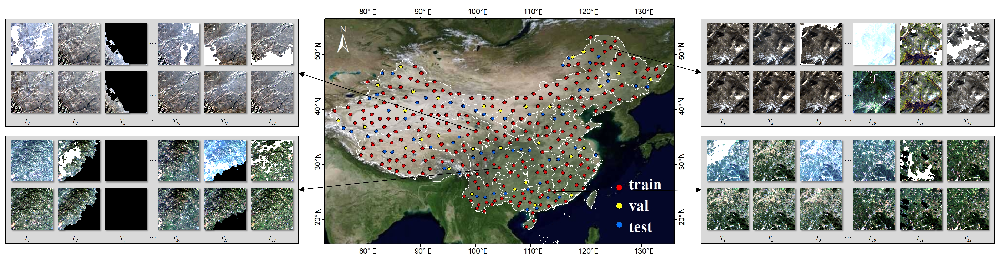

# MixCloudSeqRecon

**Physics-informed synthesis and reconstruction of cloud-free reflectance sequences under mixed cloud conditions.**

MixCloudSeqRecon combines MixCloudSynth, which constructs paired cloudy and clear reflectance sequences, with MixCloudFormer for reconstructing sequences affected by thin and thick clouds.

## MixCloudSeqPairs Dataset construction

## Application

Regional application results will be added here.

**Code will be released upon acceptance of the paper.**
