# MixCloudSeqRecon

**Physics-informed synthesis and reconstruction of cloud-free reflectance sequences under mixed cloud conditions.**

MixCloudSeqRecon combines MixCloudSynth, which constructs paired cloudy and clear reflectance sequences, with MixCloudFormer for reconstructing sequences affected by thin and thick clouds.

## MixCloudSeqPairs Dataset

## Application (2025)

Monthly raw observations and reconstructed reflectance across six cities.

### Beijing

| | | | | | |
|:---:|:---:|:---:|:---:|:---:|:---:|
| **Jan · Raw** 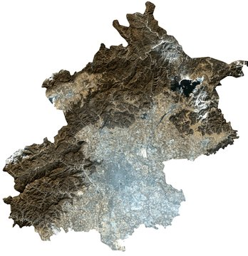 | **Feb · Raw** 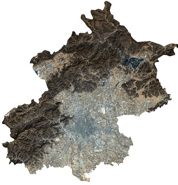 | **Mar · Raw** 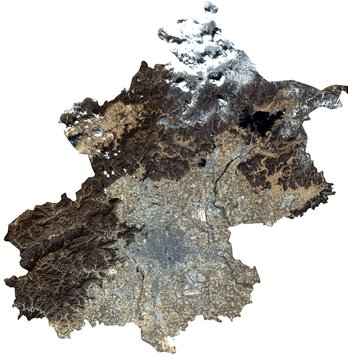 | **Apr · Raw** 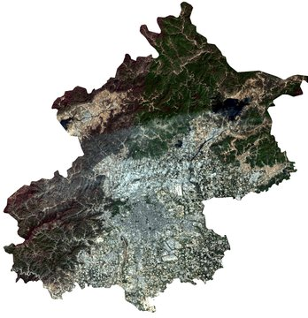 | **May · Raw** 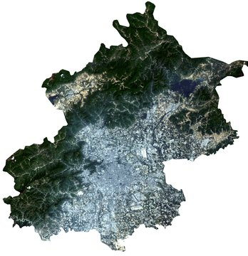 | **Jun · Raw** 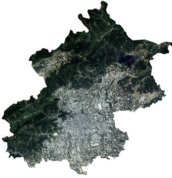 |
| **Jul · Raw** 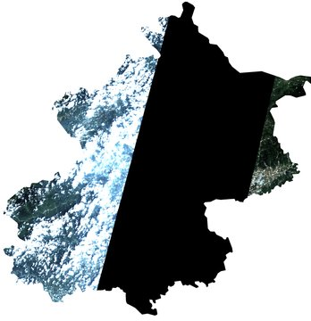 | **Aug · Raw** 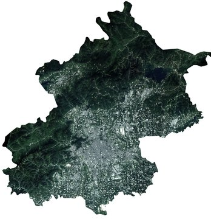 | **Sep · Raw** 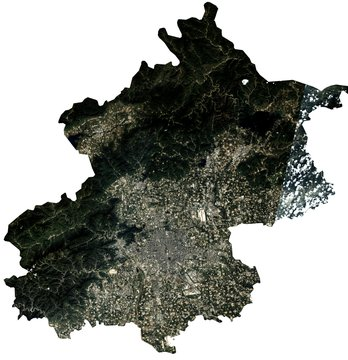 | **Oct · Raw** 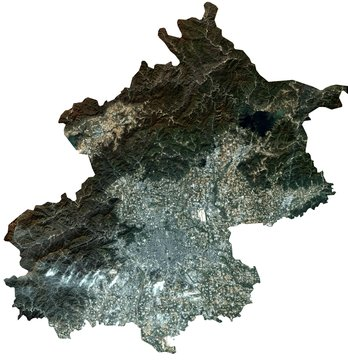 | **Nov · Raw** 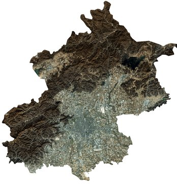 | **Dec · Raw** 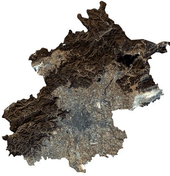 |
| **Jan · Result** 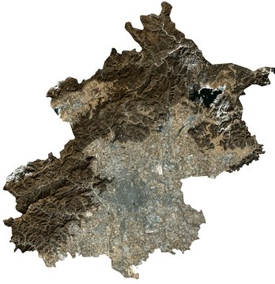 | **Feb · Result** 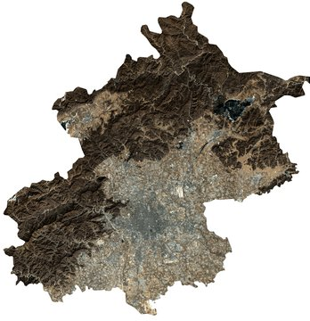 | **Mar · Result** 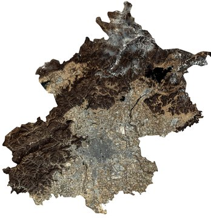 | **Apr · Result** 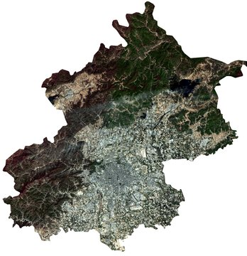 | **May · Result** 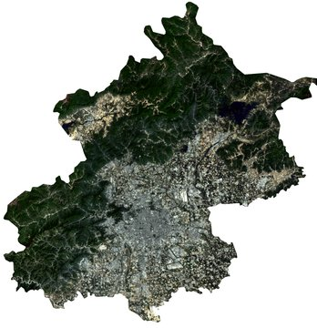 | **Jun · Result** 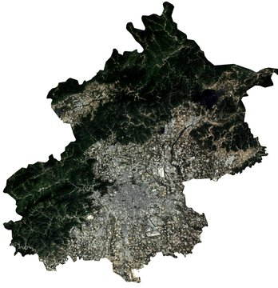 |
| **Jul · Result** 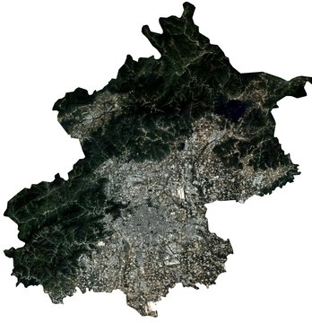 | **Aug · Result** 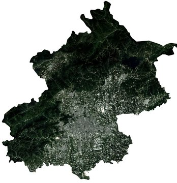 | **Sep · Result** 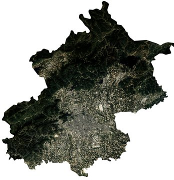 | **Oct · Result** 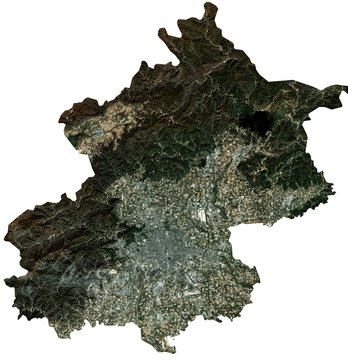 | **Nov · Result**  | **Dec · Result** 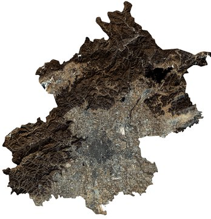 |

### Harbin

| | | | | | |
|:---:|:---:|:---:|:---:|:---:|:---:|
| **Jan · Raw** 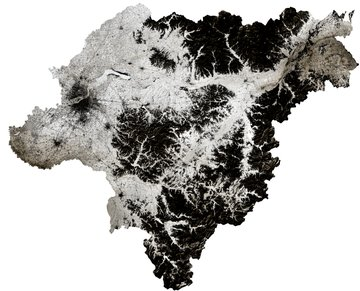 | **Feb · Raw** 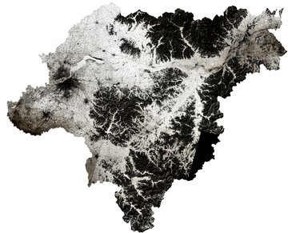 | **Mar · Raw** 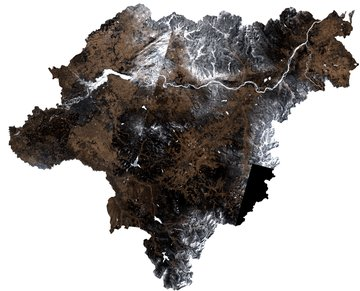 | **Apr · Raw** 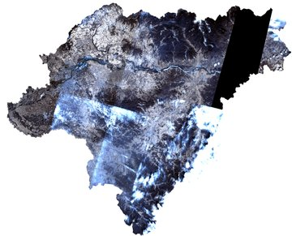 | **May · Raw** 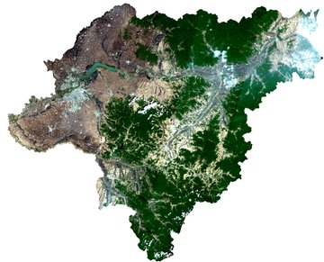 | **Jun · Raw** 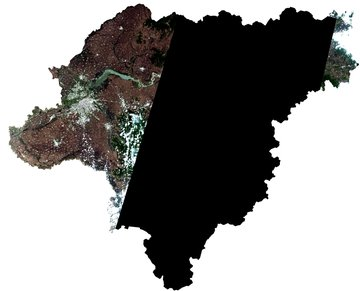 |
| **Jul · Raw** 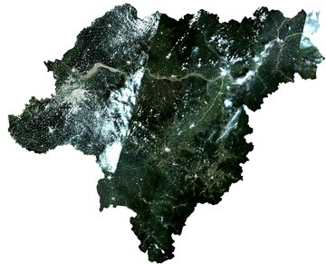 | **Aug · Raw** 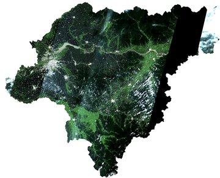 | **Sep · Raw** 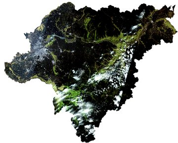 | **Oct · Raw** 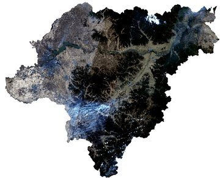 | **Nov · Raw** 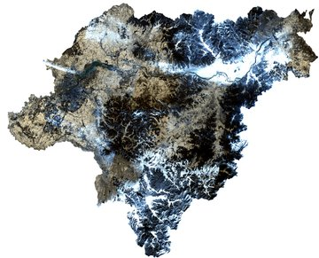 | **Dec · Raw** 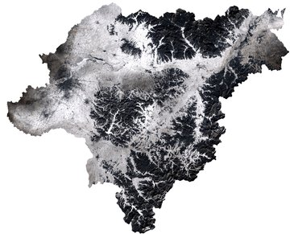 |
| **Jan · Result** 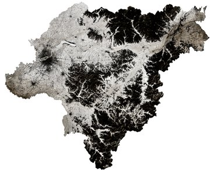 | **Feb · Result** 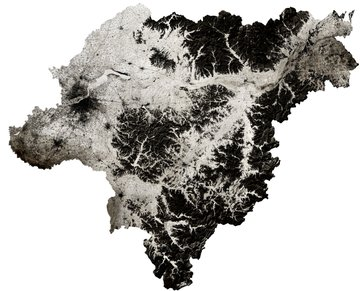 | **Mar · Result** 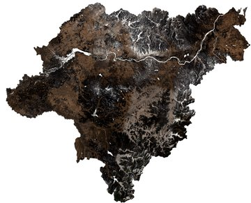 | **Apr · Result** 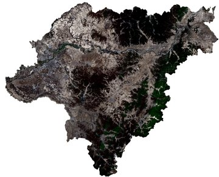 | **May · Result** 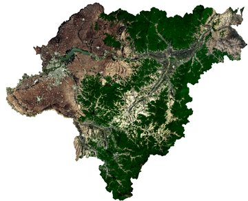 | **Jun · Result** 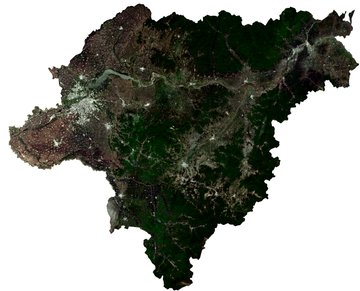 |
| **Jul · Result** 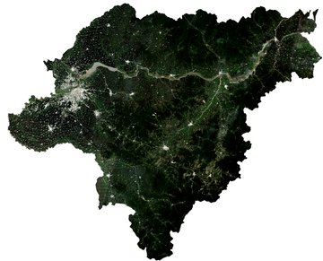 | **Aug · Result** 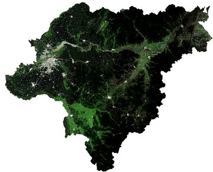 | **Sep · Result** 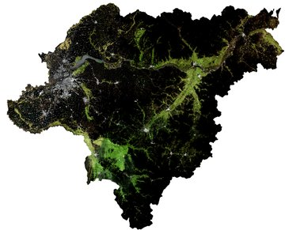 | **Oct · Result** 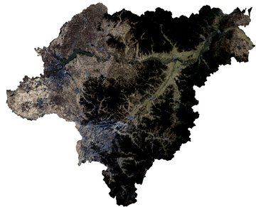 | **Nov · Result** 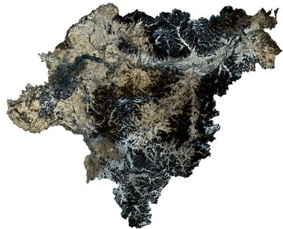 | **Dec · Result** 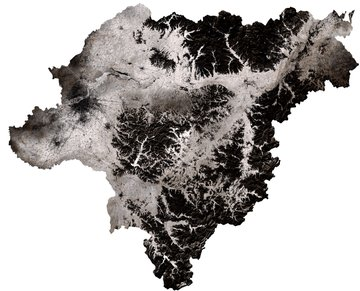 |

### Kunming

| | | | | | |
|:---:|:---:|:---:|:---:|:---:|:---:|
| **Jan · Raw** 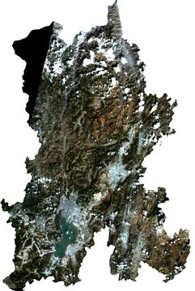 | **Feb · Raw** 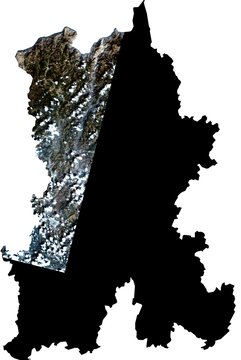 | **Mar · Raw** 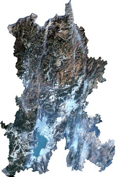 | **Apr · Raw**  | **May · Raw**  | **Jun · Raw**  |
| **Jul · Raw**  | **Aug · Raw**  | **Sep · Raw**  | **Oct · Raw**  | **Nov · Raw**  | **Dec · Raw**  |
| **Jan · Result**  | **Feb · Result**  | **Mar · Result**  | **Apr · Result**  | **May · Result**  | **Jun · Result**  |
| **Jul · Result**  | **Aug · Result**  | **Sep · Result**  | **Oct · Result**  | **Nov · Result**  | **Dec · Result**  |

### Wuhan

| | | | | | |
|:---:|:---:|:---:|:---:|:---:|:---:|
| **Jan · Raw**  | **Feb · Raw**  | **Mar · Raw**  | **Apr · Raw**  | **May · Raw**  | **Jun · Raw**  |
| **Jul · Raw**  | **Aug · Raw**  | **Sep · Raw**  | **Oct · Raw**  | **Nov · Raw**  | **Dec · Raw**  |
| **Jan · Result**  | **Feb · Result**  | **Mar · Result**  | **Apr · Result**  | **May · Result**  | **Jun · Result**  |
| **Jul · Result**  | **Aug · Result**  | **Sep · Result**  | **Oct · Result**  | **Nov · Result**  | **Dec · Result**  |

### Xining

| | | | | | |
|:---:|:---:|:---:|:---:|:---:|:---:|
| **Jan · Raw**  | **Feb · Raw**  | **Mar · Raw**  | **Apr · Raw**  | **May · Raw**  | **Jun · Raw**  |
| **Jul · Raw**  | **Aug · Raw**  | **Sep · Raw**  | **Oct · Raw**  | **Nov · Raw**  | **Dec · Raw**  |
| **Jan · Result**  | **Feb · Result**  | **Mar · Result**  | **Apr · Result**  | **May · Result**  | **Jun · Result**  |
| **Jul · Result**  | **Aug · Result**  | **Sep · Result**  | **Oct · Result**  | **Nov · Result**  | **Dec · Result**  |

**Code will be released upon acceptance of the paper.**
